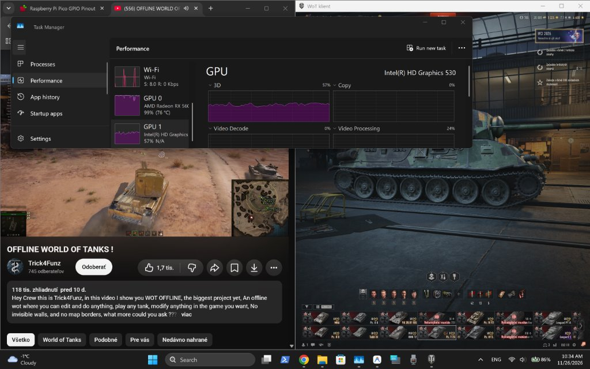
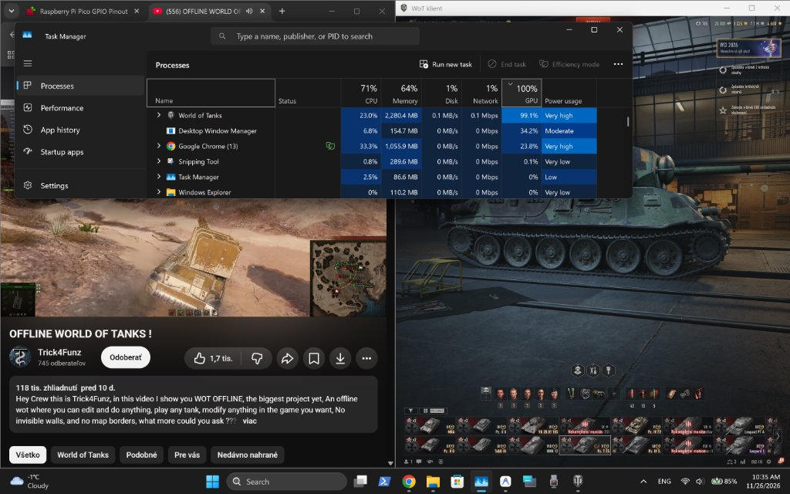

# MacBookPro13,3 Windows 11 Dual-GPU Hack (Intel HD 530 + AMD Radeon Pro 455)

Engineering research, firmware/ACPI forensics, and UEFI/SSDT blueprint for enabling **Intel HD Graphics 530** (`PCI 00:02.0`) alongside **AMD Radeon Pro 455** (`Polaris 11`, `PCI 01:00.0`) on an Apple **MacBookPro13,3** (15" Late 2016 Touch Bar, **Apple T1** — pre-T2 Indexed I/O GMUX `Renesas R4F2113`) running **Windows 11 Boot Camp** (with HVCI enabled).

> **Interactive Checkpoint & Full Documentation:** Open [`index.html`](index.html) locally in any browser (100% offline, searchable, links directly to all dumps, decompiled ACPI tables, scripts, and reference sources), or read the Markdown specification in [`docs/macbookpro13_3_windows_dual_gpu_spec.md`](docs/macbookpro13_3_windows_dual_gpu_spec.md).
> **Undocumented Hardware Discoveries (Interactive Reference):** Open [`docs/undocumented_hardware_findings_en.html`](docs/undocumented_hardware_findings_en.html) (**English**) or [`docs/undocumented_hardware_findings.html`](docs/undocumented_hardware_findings.html) (**Slovak**) for a 100% offline reference of all Apple EFI (`HB80`), Polaris 11 3-reg, Pre-T2 Indexed I/O GMUX, `VFCT`, `dxgkrnl`, and S3 discoveries.
> **Want to build it yourself or port it to another MacBook Pro?** See [`docs/BUILD_AND_PORT_GUIDE.md`](docs/BUILD_AND_PORT_GUIDE.md) and [`AGENTS.md`](AGENTS.md) (WSL build, `scripts/Deploy-USB.ps1 -Profile clean|dev`, internal SSD installer, and a copy-paste AI-Agent Porting Guide).
>
> [!CAUTION]
> **Hybrid `gpu-power-prefs = iGPU` vs. Classic Boot Camp:** When `gpu-power-prefs = iGPU` (`01 00 00 00`) is set in Apple NVRAM, booting classic Boot Camp directly without rEFInd/`mbp133_m2_hybrid.efi` produces a **black screen**. Always use **`Boot Camp Default`** in rEFInd or reset Apple NVRAM at startup with **`Cmd + Option + P + R`** before booting stock Boot Camp directly!

## Live Proof: Both GPUs Working Simultaneously (Hybrid Mode 5)

Real-world Windows 11 Pro capture on `MacBookPro13,3` running **Hybrid Mode 5** (internal Retina `2880×1800 @ 60 Hz` driven by Intel HD 530 while AMD Radeon RX 560X / Pro 455 renders 3D workloads on demand):

- **GPU 0 (`AMD Radeon RX 560X`):** **`99%` (`76 °C`)** running *World of Tanks* (`99.1%` GPU in Processes).
- **GPU 1 (`Intel(R) HD Graphics 530`):** **`57%`** (`3D: 57%`, `Video Processing: 24%`) driving `Desktop Window Manager` (`34.2%`) and YouTube playback in `Google Chrome` (`23.8%`) simultaneously with zero UI lag.





## Key Findings (Phase 0 Forensics Complete)

- **Root Cause of Polaris 11 `Code 43` (`BugCheck 0x1B0 / P1=0x2 / P2=0xC0000001`) after `AppleSetOs`:**
  - Decoded from live dump `WATCHDOG-20261125-1333.dmp` + AMD LZNT1 `!RCA` `CollectDbgInfo` blob (`Ev=0x900C1009`) + `amdkmdag.sys` disassembly:
  - Fails inside `PP_Initialize` with **`"PP Lib initialization failed"`** (`failure_bitmask = 0x0000000000000801`, Bit 0 + **Bit 11**).
  - The sole writer of Bit 11 (`amdkmdag+0x1718329`) is **`smum_start_smc` -> `polaris10_start_smu`** (~269 ms SMU7 handshake/start timeout).
  - **Ruled out:** `VFCT` VBIOS (`60,416 B`, `113-C9801AP-028`), PCI Config Space (`PCI_CMD=0x0407`, `D0`, `Gen3 x8`, `MSI=0x0081`), all 4 AMD BARs (`0xB0000000`, `0xC0000000`, `0x4000`, `0x82600000`), and all 24 ACPI tables (`DSDT`, `SSDT1..12`, `VFCT`, `DMAR`, `MCFG`, `XSDT`) are **100% byte-for-byte identical** between normal Boot Camp boot and `AppleSetOs` boot.
- **Verified `MacBookPro13,3` ACPI Differences vs. T2 (`Osaul4ik/t2-gmux-uefi`):**
  - GMUX is **Pre-T2 Indexed I/O (`Renesas R4F2113`)** on ports `0x0700–0x07FE` (`0x7C2`/`0x7D0`/`0x7D4`), not T2 MMIO (`0xFE0B0200`).
  - `Device (IGPU)` lives directly in `DSDT` (not `SaSsdt`), and brightness `_BCM` is on `\_SB.PCI0.IGPU.DD01._BCM` (`DD1F` has no `_BCM`).
  - `ssdt1.dsl` (`TableId="PEG0GFX0"`) already ships Apple's native Indexed I/O GMUX AML helpers: `\_SB.PCI0.PEG0.GFX0.SGMX(Port, Len, Val)`, `ABCM(Arg0)`, `PWRD`, `PUPD`, and `GXWA`.

## Repository Layout

```text
├── index.html          # Main offline interactive checkpoint & technical documentation
├── docs/               # Engineering specification, build/port guide, M1A/M1A-2/M1B/M2 runbooks & findings
├── uefi/
│   ├── m1a_probe/      # Milestone 1A read-only UEFI telemetry probe (PCI/BAR5/SMU7/GMUX/IOMMU)
│   ├── m1a2_ebs/       # Milestone 1A-2 ExitBootServices() X-Ray hook & 3-register Dual-GPU Fix
│   ├── m1b_igpu/       # Milestone 1B Intel-Only UEFI loader + SSDT_IGPU_MBP133 ACPI bridge
│   └── m2_hybrid/      # Milestone 2 Unified 4-mode Hybrid loader (VFCT/DOD/NVRAM + SSDT_HYBRID_MBP133)
├── diag/
│   ├── acpi_setos/     # 24 raw .dat + decompiled .dsl ACPI tables from AppleSetOs boot
│   ├── acpi_normal/    # 24 raw .dat + decompiled .dsl + dmar.dsl from normal boot
│   ├── dump_1b0/       # WATCHDOG-20261125-1333.dmp, extracted blobs, and kd.exe analyses
│   ├── m1a/            # Milestone 1A UEFI probe logs, Windows snapshots & diff analysis
│   ├── m1a2/           # Milestone 1A-2 ExitBootServices() X-Ray reports & Dual-GPU verification logs
│   ├── m1b/            # Milestone 1B Intel-Only UEFI logs, Windows snapshots & battery power
│   ├── m2/             # Milestone 2 Hybrid Mode 5 verification logs (including post-S3 wake)
│   └── pci_state_*.txt # PnP / D-state / driver stack snapshots for both boot modes
├── scripts/            # Deploy-USB.ps1 (clean/dev), telemetry collectors, Boot Camp fix & rEFInd configs
├── tools/acpica/       # Intel ACPICA 20260408 Windows tools (acpidump, iasl, acpixtract)
└── reference/          # Primary upstream reference code (Linux apple-gmux/polaris10_smumgr, t2-gmux-uefi, apple_set_os)
```

## Milestones

1. **Milestone 1A (UEFI Telemetry & `igdkmd64.sys` Isolation — Completed):**
   - UEFI probe (`uefi/m1a_probe/mbp133_m1a_probe.c`), Windows collector/isolator (`scripts/Run-M1A-Collect.ps1`), diff analyzer (`scripts/Parse-M1A-Probe.py`), runbook ([`docs/MILESTONE_1A_RUNBOOK.md`](docs/MILESTONE_1A_RUNBOOK.md)), raw analysis ([`diag/m1a/M1A_ANALYSIS.md`](diag/m1a/M1A_ANALYSIS.md)), and **verified findings** ([`docs/MILESTONE_1A_FINDINGS.md`](docs/MILESTONE_1A_FINDINGS.md)):
   - **Proved:** `igdkmd64.sys` driver conflict (H2) is **100% disproven**; pre-`ExitBootServices` UEFI state is **100% identical** between `normal`, `SetOS 10.15`, and `SetOS 10.9`; Intel OpRegion already carries `$VBT SKYLAKE` and Indexed I/O GMUX (`0x55AA`, `0x04001D00`) is hardware-verified.
2. **Milestone 1B (Completed & Verified on Hardware — Intel-Only Mode 4 Works End-to-End):**
   - UEFI loader (`uefi/m1b_igpu/mbp133_m1b_igpu.c`), ACPI bridge (`uefi/m1b_igpu/SSDT_IGPU_MBP133.asl`), collector (`scripts/Run-M1B-Collect.ps1`), runbook ([`docs/MILESTONE_1B_RUNBOOK.md`](docs/MILESTONE_1B_RUNBOOK.md)), and **verified findings** ([`docs/MILESTONE_1B_FINDINGS.md`](docs/MILESTONE_1B_FINDINGS.md)).
   - **Proved:** Intel HD 530 (`00:02.0`) drives `2880×1800 @ 60 Hz` with Apple `$VBT SKYLAKE`, `DDI_BUF_CTL_A=0x91`, **`BDB[43] → NONE` smooth GMUX brightness**, **full `Standby (S3)` lid-close sleep/wake**, AMD `01:00.0` powered off (`GMUX 0x50=0x00`), and battery draw **`9.34 W`** (~7–8 W savings).
3. **Milestone 1A-2 (Completed & Verified on Hardware — Dual-GPU `Code 43` Solved!):**
   - `ExitBootServices()` X-Ray & Dual-GPU Fix (`uefi/m1a2_ebs/mbp133_m1a2_ebs.c`), ACPI `M1A2` reader (`scripts/Read-M1A2-Ebs.py`), runbook ([`docs/MILESTONE_1A2_RUNBOOK.md`](docs/MILESTONE_1A2_RUNBOOK.md)), and **verified findings** ([`docs/MILESTONE_1A2_FINDINGS.md`](docs/MILESTONE_1A2_FINDINGS.md)).
   - **Proved:** `AppleSetOs("Mac OS X 10.15")` skips Apple EFI's Boot Camp `ExitBootServices()` callback (keeping Intel `DEVEN.D2EN=1` instead of locking `HB80=1`), which left Polaris 11 VRAM unrelocated (`0x007F0000`). Writing all **3 Boot Camp `BAR5` registers post-EBS** (`MC_VM_FB_LOCATION=0xF47FF400`, `HDP_NONSURFACE_BASE=0xF4000000`, `GRPH_PRIMARY_SURFACE_ADDRESS_HIGH=0xF4` latched via `0x1A04`) brings up **Intel HD 530 + AMD Radeon Pro 455 concurrently with zero errors (`CM_PROB_NONE`)**, `2880×1800 @ 60 Hz`, working brightness slider (`101` levels), and full **`Standby (S3)` lid-close sleep/wake**.
4. **Milestone 2 (Completed & Verified on Hardware — Hybrid Mode 5 + Internal SSD Boot Work End-to-End!):**
   - Unified 4-mode UEFI loader (`uefi/m2_hybrid/mbp133_m2_hybrid.c` with `PCH 0x0CF9` automatic NVRAM cold-reboot), Hybrid S3 ACPI bridge (`uefi/m2_hybrid/SSDT_HYBRID_MBP133.asl`), `M2HY`/telemetry collector (`scripts/Read-M2-Hybrid.py`), USB & internal SSD deployment (`scripts/Deploy-USB.ps1`, `scripts/Install-InternalESP.ps1`, `scripts/macos/bless-refind.command`), runbook ([`docs/MILESTONE_2_RUNBOOK.md`](docs/MILESTONE_2_RUNBOOK.md)), and **verified findings** ([`docs/MILESTONE_2_FINDINGS.md`](docs/MILESTONE_2_FINDINGS.md)).
   - **Proved:** Combining Apple NVRAM `gpu-power-prefs = iGPU` (`ColdRebootNow()` via `PCH 0x0CF9`), post-EBS 3-register Polaris 11 relocation, in-memory `VFCT` eDP/LCD1 removal (`dev_sup 0x068A -> 0x0688`, `dp`/`conn`/`enc` `5 -> 4`, bypassing `dxgkrnl!DpiFdoEnumChildDevices 0xC00000BB`), `PEG0GFX0._DOD -> XDOD`, and `SSDT_HYBRID_MBP133.aml` (never cutting GMUX port `0x50`) drives `2880×1800 @ 60 Hz` (`101` brightness levels, `dwm`/`Antigravity`, zero lag) on **Intel HD 530 (`OK`)** while keeping **AMD RX 560X / Pro 455 (`OK`, `5.7 MB` idle VRAM, DXGI `#0 HIGH_PERFORMANCE`)** active across **`Standby (S3)` lid-close sleep/wake**.
   - **USB-First Safety Rule:** Always test everything on an external FAT32 USB rEFInd drive first ([`docs/BUILD_AND_PORT_GUIDE.md`](docs/BUILD_AND_PORT_GUIDE.md)); only install onto the internal NVMe ESP (`Install-InternalESP.ps1` + macOS Recovery `Cmd+R` `bless-refind.command`) once USB works cleanly, and keep the USB stick as a rescue boot drive.

## Author & Credits

Researched, reverse-engineered, and implemented by **Martin Tarasovič** — [`github.com/tarasovic7`](https://github.com/tarasovic7).

If this repository (or an AI agent using it) helped unlock Dual-GPU / Hybrid mode on your MacBook Pro under Windows:
- Please leave a **Star** on [`github.com/tarasovic7/macbookpro13-3-dual-gpu`](https://github.com/tarasovic7/macbookpro13-3-dual-gpu)
- Share it on **X (x.com)**, **LinkedIn**, or **Facebook** with credit to [`@tarasovic7`](https://github.com/tarasovic7) so more Boot Camp users can benefit!

### Built On & Inspired By (Upstream Projects)
This project builds upon and adapts prior open-source hardware research and tools:
- **[Osaul4ik/t2-gmux-uefi](https://github.com/Osaul4ik/t2-gmux-uefi)** — Primary inspiration for UEFI GMUX display switching, Intel eDP `DDI_BUF_CTL_A` 4-lane strap, OpRegion VBT `BDB[43]` backlight handling, in-memory DSDT method renaming, and ACPI SSDT brightness/S3 bridging.
- **[0xbb/apple_set_os.efi](https://github.com/0xbb/apple_set_os.efi)** & **[0xbb/gpu-switch](https://github.com/0xbb/gpu-switch)** — `EFI_APPLE_SET_OS_PROTOCOL` invocation and Apple NVRAM `gpu-power-prefs` (`FA4CE28D-B62F-4C99-9CC3-6815686E30F9`) switching.
- **Linux Kernel ([torvalds/linux](https://github.com/torvalds/linux)):** [`apple-gmux.c`](https://github.com/torvalds/linux/blob/master/drivers/platform/x86/apple-gmux.c) & [`apple-gmux.h`](https://github.com/torvalds/linux/blob/master/include/linux/apple-gmux.h) (Pre-T2 Renesas Indexed I/O GMUX `0x7C2`/`0x7D0`/`0x7D4` protocol & power-rail IRQ handshake) and `amdgpu` PowerPlay `polaris10_smumgr.c` (Polaris 11 SMU7 Boot ROM & indirect register reference).
- **[aa15032261/apple_set_os-loader](https://github.com/aa15032261/apple_set_os-loader)** & **[Dunedan/mbp-2016-linux (Issue #6)](https://github.com/Dunedan/mbp-2016-linux/issues/6)** — Community research on `MacBookPro13,3` Polaris `Code 43` and GMUX power behavior.
- **Boot & Build Toolchain:** **[rEFInd](https://www.rodsbooks.com/refind/)** (Roderick W. Smith), **[GNU-EFI](https://sourceforge.net/projects/gnu-efi/)**, and **[Intel ACPICA](https://www.acpica.org/downloads/binary-tools)** (`acpidump` / `iasl`).
