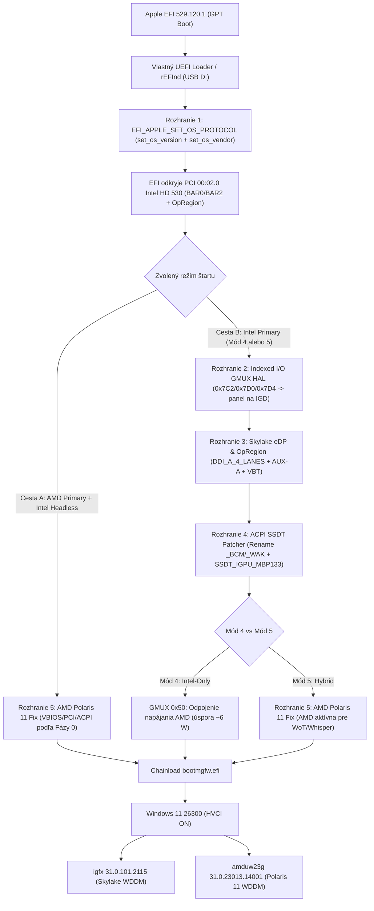

# Technická špecifikácia: Dual-GPU Hack pre MacBookPro13,3 (Windows 11 Boot Camp)

> [!IMPORTANT]
> Tento dokument zhŕňa presné overené hardvérové parametre tvojho **MacBookPro13,3**, definície všetkých 5 nízkoúrovňových rozhraní (UEFI, GMUX, Intel eDP/VBT, ACPI, AMD WDDM) a exaktný plán, čo už existuje v open-source projektoch a čo je potrebné **dopracovať alebo portovať** pre tvoj model.
>
> Všetky položky sú prísne rozdelené na **Overené na tvojom stroji / v zdrojovom kóde** a **Hypotézy na overenie vo Fáze 0** (aby sa nepísal kód naslepo bez výpisu `WATCHDOG` dumpu a tvojho `DSDT`/`SSDT`).

---

## 1. Cieľ projektu a dve architektonické cesty

**Praktický cieľ:** Odbremeniť **AMD Radeon Pro 455 (2 GB GDDR5 VRAM)** od desktopu, Electron aplikácií (`Antigravity`, `Edge WebView2`, `PowerToys`) a prehliadača ich presunutím na **Intel HD Graphics 530** (zdieľaná 16 GB RAM), pričom AMD zostane voľná pre **World of Tanks** a **Whisper** (prípadne sa dá úplne vypnúť pre úsporu ~6 W).

Existujú **dve zásadne odlišné cesty** (a jedna medzistanica):

| Cesta | Primárny displej (`APPA030`) | Sekundárna GPU | Výhody | Čo rieši / vyžaduje |
| :--- | :--- | :--- | :--- | :--- |
| **Cesta A: AMD Primary + Intel Headless** | AMD Radeon Pro 455 (bez zásahu do GMUX) | Intel HD 530 (render-only cez WDDM Hybrid) | Natívny jas, spánok S3, všetky 4× TB3 porty, nulová práca s GMUX a VBT | Vyžaduje **iba** opraviť pád `amduw23g` (`0x1B0 / 0xC0000001`) po `AppleSetOs` |
| **Cesta B — Mód 4: Intel-Only (Úsporný)** | Intel HD 530 (GMUX prepnutý na IGD) | AMD úplne odpojená od napájania (`gmux 0x50`) | Úspora ~6 W (17,2 W → 11,1 W), tichý chod; **nevyžaduje** opravu AMD `Code 43` | Vyžaduje port `t2-gmux-uefi` na Indexed I/O GMUX + VBT + ACPI jas/spánok (bez WoT/externých monitorov) |
| **Cesta B — Mód 5: Hybrid (Intel Primary + AMD Secondary)** | Intel HD 530 (GMUX prepnutý na IGD) | AMD Radeon Pro 455 zapnutá pre WoT / Whisper / externé TB3 monitory | Kompletné odbremenenie AMD VRAM (desktop na Intel, 3D/Compute na AMD) | Vyžaduje **všetko z Módu 4** (bez vypnutia napájania AMD) **PLUS** opravu AMD `0xC0000001` z Cesty A |

> [!TIP]
> **Strategický záver:** Fáza 0 (analýza dumpu `WATCHDOG-20261125-1333.dmp` a porovnanie ACPI/PCI) je povinná pre **Cestu A aj Cestu B (Mód 5)**, pretože v oboch prípadoch musí `amduw23g` prejsť cez `DxgkDdiStartDevice` bez `STATUS_UNSUCCESSFUL`. Ak Cesta A vyrieši AMD štart jednoduchým ACPI/VBIOS/PCI fixom, získaš funkčný dual-GPU systém bez nutnosti riešiť eDP VBT a S3 GMUX re-routing!

---

## 2. Overený inventár hardvéru a zlyhania (`MacBookPro13,3`)

Všetky hodnoty nižšie boli načítané priamo z tvojho systému:

### 2.1 Platforma a firmvér
- **Model / Board ID:** `Apple Inc. MacBookPro13,3` / `Mac-A5C67F76ED83108C` (15" Late 2016 Touch Bar)
- **Koproc / iBridge:** **Apple T1** (`USB\VID_05AC&PID_8600`) — **NIE T2!** (zásadný rozdiel pre GMUX protokol)
- **EFI Firmware:** `529.120.1.0.0` (2024-03-14), UEFI GPT
- **OS:** Windows 11 Pro `10.0.26300` (x64), **HVCI / VBS zapnuté** (`HvciEnabled`, `HvciStrictMode`), Smart App Control `Off`, Boot Camp `6.1.6655`
- **CPU / RAM:** `Intel Core i7-6920HQ` (Skylake 6. gen, `CPUID 0x506E3`), 16 GB RAM

### 2.2 PCI, ACPI a pamäťová mapa grafického subsystému

| Zariadenie | PCI BDF | Hardware ID | ACPI cesta | Pridelené prostriedky (pri `AppleSetOs`) | Aktuálny ovládač |
| :--- | :--- | :--- | :--- | :--- | :--- |
| **Intel HD Graphics 530** | `00:02.0` | `PCI\VEN_8086&DEV_191B&SUBSYS_015F106B&REV_06` | `\_SB.PCI0.IGPU` | `BAR0=0x81000000`, `BAR2=0xA0000000`, I/O `0x5000`, IRQ pridelené | Intel `31.0.101.2115` (`igfx`, finálny WHQL pre Skylake) — **OK (`D0`)** |
| **PEG0 Root Port** | `00:01.0` | `PCI\VEN_8086&DEV_1901&SUBSYS_015F106B&REV_07` | `\_SB.PCI0.PEG0` | Bridge pre `Bus 1` | `pci.sys` — **OK** |
| **AMD Radeon Pro 455** *(Polaris 11)* | `01:00.0` | `PCI\VEN_1002&DEV_67EF&SUBSYS_0166106B&REV_C7` | `\_SB.PCI0.PEG0.GFX0` | `0xB0000000`, `0xC0000000`, `0x82600000`, I/O `0x4000`, **bez IRQ** | R.ID `25.3.1-R2.5` (`31.0.23013.14001`, `amduw23g`) — **Code 43 (`D3`)** |
| **AMD HDMI/DP Audio** | `01:00.1` | `PCI\VEN_1002&DEV_AAE0&...` | `\_SB.PCI0.PEG0.HDAU` | Func 1 na `PEG0` | OK |
| **LPC Bridge (PCH)** | `00:1F.0` | `PCI\VEN_8086&DEV_A151` (100 Series / QMS180) | `\_SB.PCI0.LPCB` | LPC dekódovanie I/O | `msisadrv` — OK |
| **Apple GMUX** *(Renesas R4F2113)* | LPC/ACPI | `ACPI\APP000B\4&1096773&0` | `\_SB.PCI0.LPCB.GMUX` | **I/O porty `0x0700–0x07FE`** (`IORESOURCE_IO`) | Boot Camp `oem7.inf` (`6.1.8100.0`, `NullDeviceInstall.NT`) |
| **Apple Panel Backlight** | ACPI | `ACPI\APP0002` | `\_SB.PNLF` | ACPI | Boot Camp `oem7.inf` (`NullDeviceInstall.NT`) |
| **Interný Retina panel** | eDP | `DISPLAY\APPA030` (`2880×1800 @ 60 Hz`) | — | eDP mux (`CBTL06142` / `HD3SS212` / `PI3VDP12412`) | `monitor.sys` |

> [!WARNING]
> **Kľúčový rozdiel oproti T2 MacBookPro16,1 (`t2-gmux-uefi`):**
> 1. **GMUX zbernica:** T2 používa MMIO `0xFE0B0200`. Tvoj `MacBookPro13,3` používa **Indexed I/O na portoch `0x0700–0x07FE`** (`Renesas R4F2113`).
> 2. **ACPI strom AMD:** T2 `16,1` má extra PCIe mostíky `\_SB.PCI0.PEG0.EGP0.EGP1.GFX0`. Tvoj `13,3` má AMD priamo na **`\_SB.PCI0.PEG0.GFX0`**.
> 3. **Externé porty:** Všetky 4× Thunderbolt 3 / USB-C výstupy sú hardvérovo zapojené **výlučne na AMD dGPU**.

### 2.3 Presný podpis zlyhania pri boote cez `AppleSetOs` (OVERENÉ Z DUMPU A DISASSEMBLY!)

Zaznamenané a **kompletne dekódované** z `WATCHDOG-20261125-1333.dmp` (sekundárny blob `{270A33FD-…}` + LZNT1 `!RCA` logy `amdkmdag.sys` `TimeStamp=0x659F9E35`):

```text
BugCheck:  0x1B0  (VIDEO_MINIPORT_FAILED_LIVEDUMP)
P1:        0x2    (DXGK_MINIPORT_START_DEVICE_FAILURE — zlyhal DxgkDdiStartDevice)
P2:        0xFFFFFFFFC0000001  (STATUS_UNSUCCESSFUL)
P4:        0xFFFFF8036E154684  (amdkmdag+0x16F4684 = DxgkDdiStartDevice)
Stav PnP:  ProblemCode = 43 (CM_PROB_FAILED_POST_START), MostRecentPowerState = 4 (D3)
```

> [!IMPORTANT]
> **PRESNÁ PRÍČINA ZLYHANIA (100 % dokázané z `amdkmdag` ALOG `Ev=0x900C1009` a disassembly `PAGEPPLC`):**
> - **Assert v `amdkmdag.sys`:** `"PP Lib initialization failed"` (`pInstance->PECI.failFlag.pplib_init_failure.failure_bitmask != 0`)
> - **Zachytená hodnota `failure_bitmask` (`Ev=0x900C1009`):** **`0x0000000000000801`** (`Bit 0 = 0x001` init neukončený | **`Bit 11 = 0x800`**!)
> - **Jediná inštrukcia v celom 105 MB ovládači, ktorá nastavuje Bit 11 (`0x800`):** `amdkmdag+0x1718329` (`bts qword ptr [rcx+93Bh], 0Bh`) vnútri `amdkmdag+0x17182FC` (**`smum_start_smc` → `[smumgr+0x280]` = `polaris10_start_smu`**)!
> - **Časovanie z `ALOG`:** `27.073 s` (`Ev=0x900C0402`) → `27.342 s` (`Ev=0x900C1009 = 0x0801`, tj. **~269 ms timeout pri štarte Polaris 11 SMU/SMC mikrokontroléra**).
>
> **Vyvrátené hypotézy (100 % overené v dumpe):**
> - **VBIOS NECHÝBA:** Tabuľka `VFCT` (`60 548 B`) je prítomná aj v `setos` boote a `amdkmdag` v `Ev=0x900C0E0D` úspešne načítal celých `60 416 B` ATOMBIOS VBIOS (`113-C9801AP-028`, `55 AA 76 E9`).
> - **PCIe / BAR / MSI / D0 SÚ V PORIADKU:** Decompressed `Ev=0x900C0E14` ukazuje v čase zlyhania `PCI_CMD = 0x0407` (IO+Mem+BusMaster ON), `PMCSR = 0x0000` (`D0`), PCIe link **`Gen3 x8`** (`0x1083`), MSI zapnuté (`0x0081`), všetky 4 BARy aktívne.
> - **Ostatné PowerPlay bloky prešli:** `PECI`, `SW_BGM_Manager`, `PHM`, `CWDDEPM`, `PSM`, `PEM` prešli bez chyby (bity `0x04..0x400` vyčistené).

Známa zhoda v komunite: identický `Code 43` na Polaris MacBookoch po `apple_set_os` hlásia issues `0xbb/apple_set_os.efi#25` a `aa15032261/apple_set_os-loader#4`.

---

## 3. Architektúra systému a tok riadenia



---

## 4. Fáza 0: Výsledky forenznej diagnostiky (DOKONČENÉ!)

Všetky tri kroky Fázy 0 už boli úspešne vykonané na tvojom stroji v oboch boot režimoch (`setos` aj `normal`). Výstupy sú uložené v `C:\Temp\HackDiag\`.

### 4.1 Výsledok 0.1 — Analýza `WATCHDOG-20261125-1333.dmp` + `amdkmdag.sys` (HOTOVO)
- Dekódovaný sekundárny blob `{270A33FD-…}` (`dxg_blob.bin`) a všetky 4 LZNT1 `!RCA` bloky z `amd_dbg_blob.bin` (`amdkmdag.sys` `TimeStamp=0x659F9E35`).
- **Presná príčina `Code 43`:** `amdkmdag` zlyhá v **`PP_Initialize`** s chybou `"PP Lib initialization failed"` a bitmaskou **`failure_bitmask = 0x00000801`** (`Ev=0x900C1009`).
- **Jediný zapisovateľ bitu 11 (`0x800`):** `amdkmdag+0x1718329` vnútri `smum_start_smc` → `[smumgr+0x280]` = **`polaris10_start_smu`** (~269 ms timeout pri štarte/handshake Polaris 11 SMU7 mikrokontroléra).
- `VFCT` VBIOS (`60 416 B`, `113-C9801AP-028`), PCIe link (`Gen3 x8`), `PCI_CMD=0x0407`, `PMCSR=D0`, `MSI=0x0081` aj ostatné PowerPlay vrstvy (`PECI`, `SW_BGM`, `PHM`, `CWDDEPM`, `PSM`, `PEM`) **všetky prešli bez chyby**.

### 4.2 Výsledok 0.2 — Diff `acpi_setos` vs. `acpi_normal` (HOTOVO)
- **Všetkých 24 ACPI tabuliek je BAJT PO BAJTE 100 % IDENTICKÝCH** (`SHA-256` zhoda pre `dsdt.dat`, `ssdt.dat..ssdt12.dat`, `vfct.dat`, `dmar.dat`, `mcfg.dat`, `apic.dat`, `facp.dat`, `xsdt.dat`).
- **Dôsledok:** `AppleSetOs` **NEmení** žiadnu ACPI tabuľku! Rozdiel nie je v ACPI, ale výlučne v:
  1. **Stave hardvéru / SMU7 na `01:00.0`**, ktorý zanechá Apple EFI pri `ExitBootServices()` v macOS režime vs. Boot Camp režime (napr. `smu7_is_smc_ram_running()` / `SMU_FIRMWARE` / `SMU_STATUS.SMU_PASS`), **alebo**
  2. **Správaní Windows / `amdkmdag` v prítomnosti `00:02.0` (`Intel HD 530` + IOMMU `DMAR` + `igdkmd64`)**, vrátane `DpiFdoCreateSysMmAdapter -> 0xC000000D` (`Seq 121`) alebo rozdielnej vetvy PowerPlay/SMU uploadu (`PP_EnableUploadFirmware`).
- **Zmapované reálne ACPI cesty:**
  - `Device (IGPU)` a `Device (DD01)` (`_BCM` → `ABCM`) sú priamo v **`DSDT`** (`acpi_setos/dsdt.dsl`), **NIE** v `SaSsdt` ani v `DD1F`!
  - `ssdt1.dsl` (`TableId="PEG0GFX0"`) už obsahuje kompletné Apple Indexed I/O GMUX metódy: **`\_SB.PCI0.PEG0.GFX0.SGMX`**, **`ABCM`**, **`PWRD`**, **`PUPD`**, **`GXWA`**.

### 4.3 Výsledok 0.3 — Diff AMD BARov a `DMAR` (HOTOVO)
- Všetky 4 BARy AMD `01:00.0` sú v `normal` aj `setos` boote **100 % identické**: `BAR0=0xB0000000`, `BAR2=0xC0000000`, `BAR4=0x4000`, `BAR5=0x82600000`.
- `DMAR` (VT-d IOMMU) má 2 jednotky: `0xFED90000` (vyhradená pre `00:02.0` Intel HD 530) a `0xFED91000` (`INCLUDE_PCI_ALL` pre zvyšok PCI vrátane AMD `01:00.0`).

### 4.4 Jediná otvorená otázka pred písaním Cesta-A / Mód-5 fixu
Prečo konkrétne `polaris10_start_smu` dostane timeout po `AppleSetOs`:
1. **Overenie v UEFI (pár riadkov v C loader-i):** Prečítať Polaris 11 MMIO/SMC registre cez `BAR5` (`0x82600000`) — konkrétne `ixSMC_SYSCON_CLOCK_CNTL_0`, `ixFIRMWARE_FLAGS`, `ixSMU_FIRMWARE` a `ixSMU_STATUS` — v `normal` boote vs. po `AppleSetOs` (či Apple EFI zastaví/resetuje SMU alebo zablokuje prístup na `01:00.0` pred `ExitBootServices`).
2. **Test izolácie vo Windows:** Overiť, či pri `setos` boote zlyhá `polaris10_start_smu` aj keď je `Intel HD 530` v Správcovi zariadení zakázaný (oddelí to EFI/SMU hardvérový vplyv od koexistencie `igdkmd64` + `amdkmdag` / `DMAR` pod HVCI).
3. **Alternatívny míľnik bez čakania na SMU fix:** **Cesta B — Mód 4 (Intel-Only + vypnutie napájania AMD cez `gmux 0x50`)** nevyžaduje funkčný `polaris10_start_smu` a je už na 100 % špecifikovaná a pripravená na implementáciu (fork `Osaul4ik/t2-gmux-uefi` + `gmux_indexed.c` + `SSDT_IGPU_MBP133.asl` s volaním existujúcich `SGMX`/`ABCM`).

---

## 5. Presná špecifikácia rozhraní (Interfaces)

Nižšie je definovaných všetkých **5 technických rozhraní**, ktoré spolu tvoria celý hack.

---

### Rozhranie 1: Apple UEFI OS Spoofing & NVRAM (`AppleSetOs` + `gpu-power-prefs`)

**Účel:** Presvedčiť Apple EFI firmvér, že bootuje macOS, aby odblokoval PCI zariadenie `00:02.0` (Intel HD 530), pridelil mu BARy a pripravil `OpRegion`.

#### 1.1 `EFI_APPLE_SET_OS_PROTOCOL`
- **GUID:** `{0xC5C5DA95, 0x7D5C, 0x45E6, {0xB2, 0xF1, 0x3F, 0xD5, 0x2B, 0xB1, 0x00, 0x77}}`
- **C rozhranie (overené v `0xbb/apple_set_os.efi` a `t2-gmux-uefi`):**

```c
#define EFI_APPLE_SET_OS_PROTOCOL_GUID \
    { 0xc5c5da95, 0x7d5c, 0x45e6, { 0xb2, 0xf1, 0x3f, 0xd5, 0x2b, 0xb1, 0x00, 0x77 } }

typedef struct {
    UINT64 Version;
    EFI_STATUS (EFIAPI *SetOsVersion)(IN CHAR8 *Version);
    EFI_STATUS (EFIAPI *SetOsVendor)(IN CHAR8 *Vendor);
} EFI_APPLE_SET_OS_PROTOCOL;
```

- **Sekvencia volania:**
  1. `BS->LocateProtocol(&gEfiAppleSetOsProtocolGuid, NULL, (VOID **)&AppleSetOs)`
  2. Ak `AppleSetOs->Version != 0`: zavolať `AppleSetOs->SetOsVersion("Mac OS X 10.15")` (alebo `"Mac OS X 10.9"` — overiť v Fáze 0, či verzia mení ACPI `OSYS` alebo `ATRM` vetvu!)
  3. Zavolať `AppleSetOs->SetOsVendor("Apple Inc.")`
- **Poznámka:** Na tvojom `MacBookPro13,3` už máme **overené**, že toto rozhranie funguje (rEFInd `spoof_osx_version 10.12` aj `10.15` spoľahlivo odblokuje `00:02.0` HD 530).

#### 1.2 Apple NVRAM premenná `gpu-power-prefs`
- **Vendor GUID:** `{0xFA4CE28D, 0xB62F, 0x4C99, {0x9C, 0xC3, 0x68, 0x15, 0x68, 0x6E, 0x30, 0xF9}}`
- **Názov:** `L"gpu-power-prefs"`
- **Atribúty:** `EFI_VARIABLE_NON_VOLATILE | EFI_VARIABLE_BOOTSERVICE_ACCESS | EFI_VARIABLE_RUNTIME_ACCESS` (`0x07`)
- **Dáta (4 bajty, little-endian):**
  - `01 00 00 00` → preferovať **iGPU** pri štarte EFI
  - `00 00 00 00` (alebo zmazať premennú) → preferovať **dGPU** (štandardný stav)

> [!CAUTION]
> **Riziko NVRAM:** Zápis `gpu-power-prefs = 1` sa ukladá perzistentne do NVRAM (prežije aj odpojenie USB; resetuje sa cez `Cmd+Opt+P+R`). Na `MacBookPro13,3` zatiaľ **nie je overené**, či samotné EFI pri `gpu-power-prefs = 1` zapne panel na iGPU alebo len čiernu obrazovku — preto pri vývoji **vždy preferovať per-boot prepínanie cez GMUX z USB** a do NVRAM zapisovať až po overení zálohy.

---

### Rozhranie 2: Pre-T2 Retina Indexed I/O GMUX (`Renesas R4F2113` @ `0x0700–0x07FE`)

**Účel:** Hardvérové prepínanie interného eDP multiplexora (`APPA030`), DDC/AUX, ovládanie PWM podsvietenia (`TI LP8545/LP8548`) a zapínanie/vypínanie napájacej vetvy AMD dGPU.

**Stav:** Toto je **hlavný modul, ktorý v `t2-gmux-uefi` neexistuje** (T2 tam používa MMIO `0xFE0B0200`) a musí sa implementovať podľa Linux jadra (`drivers/platform/x86/apple-gmux.c`, `include/linux/apple-gmux.h`).

#### 2.1 Fyzické I/O porty (báza `GMUX_IO_BASE = 0x0700`)

| Port (absolútny) | Offset od `0x700` | Názov v Linuxe | Účel |
| :--- | :--- | :--- | :--- |
| `0x07C2` | `0xC2` | `GMUX_PORT_VALUE` | Dátový register (8-bit, resp. `0x7C2..0x7C5` pre 32-bit `inl`/`outl` — **pozor: byte-order `be32` / `cpu_to_be32` pri 32-bit!**) |
| `0x07CC` | `0xCC` | Probe reg 0 | Detekcia Indexed GMUX (zápis `0xAA`) |
| `0x07CD` | `0xCD` | Probe reg 1 | Detekcia Indexed GMUX (zápis `0x55`) |
| `0x07CE` | `0xCE` | Probe reg 2 | Detekcia Indexed GMUX (zápis `0x00`) |
| `0x07D0` | `0xD0` | `GMUX_PORT_READ` | Spustenie čítania (zápis logickej adresy registra) + ack/clear statusu |
| `0x07D4` | `0xD4` | `GMUX_PORT_WRITE` | Stavový bit (`bit 0`: `0` = ready, `1` = complete) + spustenie zápisu (zápis logickej adresy registra) |

#### 2.2 Protokolový stavový automat (overené v `torvalds/linux/drivers/platform/x86/apple-gmux.c`)

```c
// Detekcia Indexed I/O GMUX (Renesas R4F2113):
// outb(0xAA, 0x7CC); outb(0x55, 0x7CD); outb(0x00, 0x7CE);
// is_indexed = ((inb(0x7CC) | (inb(0x7CD) << 8)) == 0x55AA);

static BOOLEAN GmuxWaitReady(EFI_BOOT_SERVICES *BS) {
    for (UINTN i = 0; i < 200; i++) {
        UINT8 st = IoRead8(0x7D4);
        if ((st & 0x01) == 0) return TRUE;
        (VOID)IoRead8(0x7D0);      // uvoľni predošlú transakciu
        BS->Stall(100);            // 100 us
    }
    return FALSE;
}

static BOOLEAN GmuxWaitComplete(EFI_BOOT_SERVICES *BS) {
    for (UINTN i = 0; i < 200; i++) {
        UINT8 st = IoRead8(0x7D4);
        if ((st & 0x01) != 0) {
            (VOID)IoRead8(0x7D0);  // potvrď dokončenie
            return TRUE;
        }
        BS->Stall(100);            // 100 us
    }
    return FALSE;
}

BOOLEAN GmuxIdxRead8(EFI_BOOT_SERVICES *BS, UINT8 Port, UINT8 *Out) {
    if (!GmuxWaitReady(BS)) return FALSE;
    IoWrite8(0x7D0, Port);
    if (!GmuxWaitComplete(BS)) return FALSE;
    *Out = IoRead8(0x7C2);
    return TRUE;
}

BOOLEAN GmuxIdxWrite8(EFI_BOOT_SERVICES *BS, UINT8 Port, UINT8 Val) {
    IoWrite8(0x7C2, Val);
    if (!GmuxWaitReady(BS)) return FALSE;
    IoWrite8(0x7D4, Port);
    return GmuxWaitComplete(BS);
}

// 32-bit čítanie/zápis (pre verziu 0x04 a jas 0x70/0x74):
// Read32:  GmuxWaitReady -> IoWrite8(0x7D0, Port) -> GmuxWaitComplete -> val = IoRead32(0x7C2)
// Write32: IoWrite32(0x7C2, Val) -> GmuxWaitReady -> IoWrite8(0x7D4, Port) -> GmuxWaitComplete
// POZOR: Overiť v UEFI (Read32 na 0x04 a 0x70) endianitu — Linux používa inl()/outl() na 0x7C2
// priamo (little-endian na x86) pre Indexed GMUX; big-endian swap bol len na staršom PIO GMUX!
```

> [!NOTE]
> V UEFI na `x86_64` možno `IoRead8`/`IoWrite8`/`IoRead32`/`IoWrite32` realizovať buď priamo cez inline asm (`inb`/`outb`/`inl`/`outl`) alebo cez štandardný `EFI_CPU_IO2_PROTOCOL` (`CpuIo->Io.Read` / `CpuIo->Io.Write`).

#### 2.3 Logická mapa GMUX registrov (spoločná pre Indexed aj MMIO GMUX)

| Logický port | Názov | Šírka | Hodnoty / Význam |
| :--- | :--- | :--- | :--- |
| `0x04` | `VERSION_MAJOR` | 32-bit (indexed) | Verzia firmvéru GMUX (`(v >> 24) & 0xFF`, `(v >> 16) & 0xFF`, `(v >> 8) & 0xFF`) |
| `0x10` | `SWITCH_DISPLAY` | 8-bit | Zápis: `0x02` = **IGD (Intel)**, `0x03` = **DIS (AMD)**; Čítanie bit 0: `0` = IGD, `1` = DIS |
| `0x14` | `INTERRUPT_ENABLE` | 8-bit | `0xFF` = povoliť všetky IRQ udalosti, `0x00` = zakázať |
| `0x16` | `INTERRUPT_STATUS` | 8-bit | Bit 0 = DISPLAY, **Bit 2 (`0x04`) = POWER**, Bit 3 (`0x08`) = HOTPLUG; zápis načítanej hodnoty vymaže bity |
| `0x28` | `SWITCH_DDC` | 8-bit | Zápis: `0x01` = **IGD**, `0x02` = **DIS** |
| `0x40` | `SWITCH_EXTERNAL` | 8-bit | Zápis: `0x02` = IGD, `0x03` = **DIS** *(Thunderbolt Mac MUSÍ ponechať `0x03`!)* |
| `0x50` | `DISCRETE_POWER` | 8-bit | **Zapnúť dGPU:** zapíš `0x01`, potom `0x03`; **Vypnúť dGPU:** zapíš `0x01`, potom `0x00`; počkaj na bit `0x04` v porte `0x16` (max 250 ms) |
| `0x70` | `MAX_BRIGHTNESS` | 32-bit | Maximálna hodnota jasu PWM (typicky `0x0001FFFF` alebo podobná 24-bit hodnota) |
| `0x74` | `BRIGHTNESS` | 32-bit | Aktuálny jas (`value & 0x00FFFFFF`, ovláda TI LP8545/LP8548 PWM) |

#### 2.4 Bezpečná sekvencia prepnutia panela na Intel (v UEFI)
1. Uložiť masku `0x14`, zapísať `0x14 = 0xFF`, vyčistiť `0x16`.
2. Prepnutie muxu (s až 3 pokusmi a readback kontrolou!):
   - `Write8(0x28, 0x01)` (DDC → IGD)
   - `Write8(0x10, 0x02)` (Display → IGD)
   - `Write8(0x40, 0x03)` (External → DIS)
   - `Stall(10000)` (10 ms ustálenie)
   - Overiť `(Read8(0x10) & 1) == 0`! **Nikdy nevypínať napájanie AMD (`0x50`), ak toto overenie zlyhá!**
3. *(Iba pre Mód 4 — Intel-Only)*: `Write8(0x50, 0x01)` → `Write8(0x50, 0x00)` → čakať na `Read8(0x16) & 0x04` (max 200 ms) → zmazať status.
4. Obnoviť pôvodnú masku `0x14`.

---

### Rozhranie 3: Intel Skylake `HD 530` (`DEV_191B`) MMIO, eDP AUX-A a OpRegion VBT

**Účel:** Apple EFI inicializuje displej cez AMD GOP a necháva Intel OpRegion **VBT Mailbox 4 prázdny** a bit `DDI_A_4_LANES` vynulovaný. Bez tohto rozhrania Windows ovládač `igfx` (`31.0.101.2115`) nevidí 4-linkový eDP Retina panel `APPA030` (2880×1800 potrebuje 4 linky HBR2, nie 2!).

> [!TIP]
> **Overená výhoda pre `MacBookPro13,3`:** Všetky nižšie uvedené BAR0 registre z `Osaul4ik/t2-gmux-uefi` (`lib/int_edp.c` a `lib/int_opregion.c`) sú identické naprieč celou **Intel Gen 9 (Skylake `DEV_191B`) aj Gen 9.5 (Coffee/Whiskey Lake)** architektúrou!

#### 3.1 PCI a MMIO registre na `00:02.0` (`GTTMMADR` = `BAR0` @ PCI `0x10`, lokálne `0x81000000`)

| Register | Offset (BAR0 / PCI) | Bity / Hodnoty | Účel |
| :--- | :--- | :--- | :--- |
| `PCI_CMD` | PCI `0x04` | Bit 1 (`0x02`) Memory Space Enable | Povoliť MMIO dekódovanie pred prístupom k BAR0 |
| `PCI_ASLS` | PCI `0xFC` | 32-bit fyzická adresa | Ukazovateľ na **Intel OpRegion** (musí začínať `"IntelGraphicsMem"`) |
| `DDI_BUF_CTL_A` | BAR0 `0x64000` | Bit 4 (`1u << 4`): **`DDI_A_4_LANES`** | **NUTNÉ NASTAVIŤ NA 1!** Bez toho Intel ovládač zamkne DDI-A na max 2 linky a 2880×1800 nikdy nenabehne |
| `DP_AUX_CH_CTL_A` | BAR0 `0x64010` | `SEND_BUSY(31)`, `DONE(30)`, `TIMEOUT(28)`, `RX_ERR(25)`, `MSG_SIZE(24:20)`, `FW_SYNC_SKL(23<<5)`, `SYNC_SKL(31)` | Komunikácia s panelom `APPA030` cez AUX-A (čítanie DPCD + EDID po prepnutí GMUX na IGD) |
| `DP_AUX_CH_DATA_A(i)` | BAR0 `0x64014 + 4*i` | `i = 0..4` (5× 32-bit big-endian) | AUX-A TX/RX dátové buffery |
| `PWR_WELL_CTL2` | BAR0 `0x45404` | `PW_PW1_REQ(29)`/`STATE(28)`, `PW_DDI_AE_REQ(3)`/`STATE(2)` | Dočasné zapnutie display power well pred AUX-A probe |
| `PP_STATUS` | BAR0 `0xC7200` | `PP_ON(31)` | Stav napájania eDP panela |
| `PP_CONTROL` | BAR0 `0xC7204` | `PP_UNLOCK(0xABCD0000)` \| `PP_FORCE_VDD(1<<3)` | Dočasné zapnutie panel VDD počas čítania DPCD/EDID (po prečítaní obnoviť!) |

#### 3.2 Intel OpRegion & VBT Mailbox 4 rozhranie
- **Hlavička OpRegion (`ASLS`):**
  - `+0x00`: Signature `"IntelGraphicsMem"` (16 B)
  - `+0x10`: `size` v KB (`uint32 * 1024`, typicky 8 KB)
  - `+0x100` (`ASLE` Mailbox 3): `rvda` (`+130`, `uint64`) a `rvds` (`+138`, `uint32`) — **skontrolovať!** Ak sú nenulové, ovládač uprednostní RVDA pred Mailbox 4!
  - **`+0x400` (`VBT` Mailbox 4):** maximálne `0x1800` bajtov (6 KB), začína 4-bajtovým podpisom `` `$VBT` ``.
- **Požadované parametre injektovaného VBT pre `MacBookPro13,3`:**
  1. **Základná šablóna (BDB verzia):** Overiť, či `t2-gmux-uefi/lib/vbt_base.c` (Whiskey Lake / Coffee Lake VBT) prijme bez chyby Skylake ovládač `31.0.101.2115`, alebo použiť čistú **Skylake (`DEV_191B`)** VBT šablónu (napr. z dumpu Skylake notebooku / Linux `intel_vbt_decode`).
  2. **EDID časovanie (`BDB 40` + `BDB 41`):** Načítať živý 128-bajtový EDID panela `APPA030` (výrobca `0x06 0x10` = `"APP"`, prvý DTD na offsete `+54`) buď z dGPU GOP (`EFI_EDID_ACTIVE_PROTOCOL`) pred prepnutím GMUX, alebo z I2C-over-AUX (`0x50`) po prepnutí GMUX, zapísať `HActive/VActive` a 18 B DTD do BDB 41 a **prepočítať 8-bit checksum na `v[26]`** (súčet celého VBT musí byť `0`).
  3. **Link Rate & Lanes (DPCD `0x001`, `0x002`, `0x010..`):** Zapísať do BDB 27 (`eDP`), vypnúť Fast Link Training.
  4. **PSR (Panel Self Refresh): VŽDY VYPNÚŤ (`PsrOk = FALSE`)** — aj keby DPCD `0x070` hlásil podporu, Intel PSR spôsobuje blikanie na Apple Retina paneloch.
  5. **Backlight Type vo VBT: `NONE` (žiadne iGPU PWM)** — podsvietenie riadi výlučne GMUX (`0x74`), nie Intel PCH PWM.

---

### Rozhranie 4: ACPI SSDT Patcher (`XSDT`/`RSDP` + `SSDT_IGPU_MBP133.asl`)

**Účel (Cesta B):**
1. Prepojiť Windows posuvník jasu (ktorý pri iGPU primárnom displeji volá `\_SB.PCI0.IGPU.DD1F._BCM`) na GMUX register `0x74` (jas).
2. Po prebudení zo spánku S3 (`_WAK`), kedy Apple firmvér automaticky vráti GMUX späť na AMD, okamžite prepnúť GMUX naspäť na Intel (`0x28=1`, `0x10=2`, `0x40=3`) a obnoviť jas.
3. *(Voliteľne pre Mód 4)* Pri `_PTS`/`_WAK` korektne obslúžiť napájaciu vetvu AMD (`0x50`) a skryť Radeon LCD `_ADR (0x0110)`.
4. *(Voliteľne pre Cestu A / Mód 5)* Ak Fáza 0 ukáže, že `amduw23g` potrebuje `ATRM` (VBIOS) alebo úpravu `_DSM`/`ATPX` na `\_SB.PCI0.PEG0.GFX0`, injektovať túto metódu rovnakým mechanizmom!

#### 4.1 UEFI In-Memory ACPI Patching Interface (už hotové v `t2-gmux-uefi/lib/int_acpi.c`)
- **Rozhranie:**
  ```c
  EFI_STATUS _INT_AcpiApplyPatch(EFI_BOOT_SERVICES *BS, EFI_SYSTEM_TABLE *ST,
                                 EFI_HANDLE ImageHandle, CHAR16 *AmlFileName, _INT_Rep *R);
  ```
- **Algoritmus (bez potreby meniť SPI Flash alebo podpisovať ovládač — HVCI-kompatibilné!):**
  1. Nájsť `RSDP` v `ST->ConfigurationTable` (`EFI_ACPI_20_TABLE_GUID`), z nej `XSDT`, z nej `FACP` (`FADT`) → `DSDT` a tabuľku `SaSsdt`.
  2. V pamäti premenovať prvý bajt AML metód a opraviť 8-bit checksum tabuľky:
     - V `SaSsdt`: `_BCM` → `XBCM`
     - V `DSDT`: `_WAK` → `XWAK` (ak náš `.aml` obsahuje `XWAK`)
     - *(Voliteľne)* V `DSDT`: `_PTS` → `XPTS` (iba ak náš `.aml` implementuje `_PTS`)
  3. Alokovať novú kópiu `XSDT` (`EfiACPIReclaimMemory`) o 8 bajtov dlhšiu, pridať ukazovateľ na náš načítaný `SSDT_IGPU_MBP133.aml`, opraviť checksum.
  4. Alokovať novú kópiu `RSDP` (`EfiACPIReclaimMemory`), nasmerovať `XsdtAddress` na nové `XSDT`, opraviť oba checksumy a publikovať cez `BS->InstallConfigurationTable(&Acpi20Guid, NewRsdp)`.

#### 4.2 Overená ACPI mapa `MacBookPro13,3` vs. `MacBookPro16,1` (z reálneho `acpi_setos` dumpu!)

| Prvok v `t2-gmux-uefi` (`16,1` T2) | Overená realita na tvojom `MacBookPro13,3` (T1) | Akcia |
| :--- | :--- | :--- |
| `SaSsdt`: `\_SB.PCI0.IGPU.DD1F._BCM` | **NIE JE v `SaSsdt` ani v `DD1F`!** `Device (IGPU)` je priamo v **[dsdt.dsl](file:///C:/Temp/HackDiag/acpi_setos/dsdt.dsl#L2669-L3058)** a jasová metóda je **`\_SB.PCI0.IGPU.DD01._BCM`** (volá `IGPU.ABCM`, `DD1F` nemá `_BCM`!) | Premenovať `\_SB.PCI0.IGPU.DD01._BCM` → `XBCM` (alebo `IGPU.ABCM` → `XBCM`) priamo v **`DSDT`**! |
| `\_SB.PCI0.PEG0.EGP0.EGP1.GFX0.ABCM` | **UŽ EXISTUJE** na ceste **`\_SB.PCI0.PEG0.GFX0.ABCM (Arg0)`** v [ssdt1.dsl](file:///C:/Temp/HackDiag/acpi_setos/ssdt1.dsl#L280-L286) (`TableId="PEG0GFX0"`): škáluje `0..100` → `0..0x3FF` a volá `SGMX(0x0774, 4, ...)`! | Priamo volať `\_SB.PCI0.PEG0.GFX0.ABCM (Arg0)` z nového `_BCM`! |
| `\_SB.PCI0.PEG0.EGP0.EGP1.GFX0.MBWR` | **UŽ EXISTUJE** ako **`\_SB.PCI0.PEG0.GFX0.SGMX (Port, Len, Val)`** v [ssdt1.dsl](file:///C:/Temp/HackDiag/acpi_setos/ssdt1.dsl#L206-L278): kompletný Indexed I/O GMUX handshake (`0x07C2..0x07C5`, `0x07D0`, `0x07D4` + `WFRD`/`WFCD`)! | V `_WAK` priamo volať `SGMX(0x0728, 1, 1)`, `SGMX(0x0710, 1, 2)`, `SGMX(0x0740, 1, 3)` — netreba písať vlastné `OperationRegion` v AML! |
| Power-rail dGPU + PCIe Gen3 workaround | **UŽ EXISTUJE** ako `\_SB.PCI0.PEG0.GFX0.PWRD` / `PUPD` / `GXWA` v [ssdt1.dsl](file:///C:/Temp/HackDiag/acpi_setos/ssdt1.dsl#L50-L203) | Použiteľné aj na výskum SMU/PCIe re-initu pre Polaris 11! |

---

### Rozhranie 5: AMD Polaris 11 (`DEV_67EF&SUBSYS_0166106B`) — WDDM, VBIOS a Registry

**Účel:** Vyriešiť `BugCheck 0x1B0 / P1=0x2 / P2=0xFFFFFFFFC0000001` (`DxgkDdiStartDevice` fail → `Code 43`), keď je viditeľná aj Intel iGPU.

#### 5.1 Tri hypotetické mechanizmy opravy (rozhodne Fáza 0.1 + 0.2 + 0.3)

| Scenár z WinDbg + ACPI/PCI diffu | Rozhranie opravy | Kde sa implementuje |
| :--- | :--- | :--- |
| **Scenár A: Chýbajúci / nečitateľný VBIOS po `AppleSetOs`** | Overiť `ATRM` ACPI metódu na `\_SB.PCI0.PEG0.GFX0` (signatúra `ATRM (Offset, Length)` vracajúca 4 KB bloky ROM) alebo PCI Expansion ROM BAR `0x30`. Ak `AppleSetOs` zakáže ROM, uložiť 64–128 KB VBIOS z normálneho bootu a podsunúť ho cez ACPI `ATRM` v SSDT alebo namapovať ROM BAR v UEFI. | UEFI + `SSDT` (`ATRM`) |
| **Scenár B: AMD KMD sa prepne do nefunkčného Hybrid/PowerXpress (`ATPX`) režimu** | Ak `amduw23g` zdeteguje 2 GPU a zlyhá na neexistujúcej PC `ATPX`/`ATCS` metóde alebo nekompatibilnom WDDM hybrid stave, opraviť buď cez registry flagy (`KMD_Enable...` / `PP_Apple_Bootcamp_Enable` / `EnableCrossDisplay` / `ATPX` stub v SSDT) alebo cez R.ID `MultiParse` INF (`u0412789_macstd_2330.inf` s explicitným `SUBSYS_0166106B`). | `SSDT` (`ATPX` / `_DSM`) alebo INF / Registry |
| **Scenár C: Nesprávny stav PCI/Power (`PEG0` / `GFX0` v `D3` alebo vypnuté dekódovanie) po `AppleSetOs`** | Pred `ExitBootServices()` v UEFI explicitne overiť a zapnúť `PCI_CMD` (BusMaster + Memory + IO), `PMCSR = D0`, prípadne zavolať `EFI_GRAPHICS_OUTPUT_PROTOCOL` / AMD UEFI GOP driver pred spustením Windows bootloadera. | UEFI Loader (`bootx64.c`) |

#### 5.2 Overené Boot Camp + Polaris 11 registre (už funkčné v [Apply-MacBookPro13-3-Fix.ps1](file:///C:/Temp/RID-Polaris/Apply-MacBookPro13-3-Fix.ps1))

Tieto kľúče pod `HKLM\SYSTEM\CurrentControlSet\Control\Class\{4d36e968-e325-11ce-bfc1-08002be10318}\000x` sú **overené a funkčné** na R.ID `25.3.1-R2.5` (`amduw23g 31.0.23013.14001`):

| Kľúč (`DWORD`) | Hodnota | Funkcia |
| :--- | :---: | :--- |
| `DalFeatureBacklightControl` | `0` | Vypína AMD interný PWM ovládač (prenecháva riadenie Apple ACPI/GMUX) |
| `PP_VariBrightFeatureEnable` | `0` | Vypína AMD Vari-Bright adaptívny jas |
| `PP_Apple_Bootcamp_Enable` | `1` | Aktivuje Apple Boot Camp kompatibilitný profil v AMD KMD |
| `KMD_EnableBrightnessInterface2` | `0` | Vynucuje klasické Boot Camp WMI rozhranie jasu |
| `DalDPSkipPowerOff` | `1` | Zabraňuje pádu eDP linky na Apple `APPA030` |
| `DalPSRFeatureEnable` | `0` | Vypína AMD eDP PSR (prevencia blikania/zamŕzania) |
| `EnableUlps` | `0` | Vypína Ultra-Low Power State (kritické pre stabilitu v dual-GPU) |
| `PP_DisableFFC` | `1` | Apple Polaris 11 power-play stabilizácia (z natívneho `oem1.inf`) |
| `PP_DisableVoltageIsland` | `1` | Apple Polaris 11 stabilizácia napäťových ostrovov (z `oem1.inf`) |
| `DisableSAMUPowerGating` | `1` | Zabraňuje zamrznutiu SAMU bloku na Polaris 11 (z `oem1.inf`) |

> [!NOTE]
> Pri R.ID `25.3.1-R2.5` maj na pamäti, že v `C:\Temp\RID-Polaris\extracted\` existuje okrem štandardného `u0412788.inf` aj špecializovaný **`u0412789_macstd_2330.inf`** (v `MultiParse`), ktorý obsahuje priamu sekciu pre `PCI\VEN_1002&DEV_67EF&SUBSYS_0166106B` (zatiaľ čo `MSFTParse` má toto ID v `ExcludeID`).

---

## 6. Matrica rozdielov: Čo už existuje vs. Čo treba dorobiť

| # | Modul | Existujúci základ | Kompatibilita s `13,3` | Čo presne treba dorobiť | Priorita |
| :-: | :--- | :--- | :---: | :--- | :---: |
| **0** | **Forenzika (`WinDbg` + `acpidump` + PCI diff)** | Nástroje: WinDbg, Intel ACPICA | — | Spustiť na tvojom stroji v `setos` aj `normal` boote; zistiť funkciu pádu `0xC0000001` a reálne ACPI cesty | **P0 (prvý krok)** |
| **1** | **UEFI Loader + `AppleSetOs`** | `Osaul4ik/t2-gmux-uefi/bootx64.c`, `0xbb/apple_set_os.efi` | **95 %** | Zostaviť základný UEFI `.efi` chainloader (alebo fork `t2-gmux-uefi`), pridať logovanie PCI/OpRegion stavu na USB | **P1** |
| **2** | **Indexed I/O GMUX HAL (`gmux_indexed.c`)** | `torvalds/linux` `apple-gmux.c` (protokol `0x7C2/0x7D0/0x7D4`) | **0 % v `t2-gmux-uefi`** | **Napísať nanovo** 6 funkcií (`Detect`, `Read8`, `Write8`, `Read32`, `Write32`, `SwitchToIGD`, `SetDiscretePower`) namiesto T2 MMIO `0xFE0B0200` | **P1** *(pre Cestu B)* |
| **3** | **Intel Skylake eDP Probe + VBT Injector** | `t2-gmux-uefi/lib/int_edp.c` + `lib/int_opregion.c` | **90 %** *(Gen9 SKL = Gen9.5 CFL registre!)* | Overiť `vbt_base.c` so Skylake `31.0.101.2115` (prípadne vygenerovať čistý Skylake VBT); otestovať `DDI_A_4_LANES` + `APPA030` EDID substitúciu | **P1** *(pre Cestu B)* |
| **4** | **ACPI Patcher + `SSDT_IGPU_MBP133.asl`** | `t2-gmux-uefi/lib/int_acpi.c` + `tools/SSDT_IGPU_BRT.asl` | **Patcher 95 %, ASL 30 %** | **Prepísať `.asl`** pre cesty z Fázy 0.2 (`\_SB.PCI0.PEG0.GFX0`, `\_SB.PCI0.LPCB.GMUX`, Indexed I/O `0x700` v AML pre `_BCM` a `_WAK`), skompilovať cez `iasl` | **P2** *(pre Cestu B)* |
| **5** | **AMD Polaris 11 `0xC0000001` Fix** | Zatiaľ neexistuje pre Polaris 11 pod Windows | **0 %** | Navrhnúť a implementovať presnú opravu podľa výsledku Fázy 0.1–0.3 (VBIOS/`ATRM` vs. `ATPX` vs. PCI/GOP stav v UEFI) | **P0/P1** *(pre Cestu A aj B-Mód 5)* |
| **6** | **Windows GPU Assignment & Power** | Windows 11 Settings → Graphics (Per-App GPU), `Apply-MacBookPro13-3-Fix.ps1` | **100 %** | Po rozbehaní oboch GPU priradiť `Antigravity`, `Edge`, `WebView2` na Power Saving (Intel HD 530) a `WorldOfTanks.exe`, `Whisper` na High Performance (AMD) | **P3** |

---

## 7. Odporúčané míľniky a bezpečnostný postup

### Bezpečnostné pravidlá vývoja
- **Všetko testuj výlučne z USB kľúča `D:` (`REFIND_USB`)** — na internú EFI partíciu (`\EFI\Microsoft\Boot\bootmgfw.efi`) vôbec nesiahaj. Odpojením USB a reštartom máš vždy okamžitý návrat do 100 % funkčného Windows s R.ID `25.3.1`.
- **Nemeň NVRAM `gpu-power-prefs`**, kým nie je overený celý eDP/VBT štart z USB.
- **HVCI / Secure Boot kompatibilita:** Všetky UEFI a ACPI zásahy prebiehajú pred `ExitBootServices()`, takže **nevyžadujú vypnutie HVCI ani Test Signing** vo Windows 11!

### Navrhované poradie míľnikov
1. **Míľnik 0 (Diagnostika — ~20 minút):** WinDbg `!analyze -v` na `WATCHDOG-20261125-1333.dmp` + `acpidump` (`setos` vs. `normal`) + výpis PCI config space.
2. **Míľnik 1 (Rozhodovací bod):**
   - Ak Fáza 0 ukáže ľahko riešiteľný AMD problém (napr. chýbajúce `ATRM`/VBIOS alebo PCI/ATPX) → urobiť najprv **Cestu A** (najrýchlejšia cesta k fungujúcemu dual-GPU pre WoT/Whisper).
   - Ak chceš zároveň úsporný režim alebo primárny desktop priamo na Intel → forknúť `Osaul4ik/t2-gmux-uefi`, vymeniť MMIO za `gmux_indexed.c` a otestovať **Mód 4 (Intel-Only)** na USB kľúči.
3. **Míľnik 2 (Plný Hybrid — Mód 5):** Spojiť funkčný GMUX+VBT+ACPI štart na Intel s funkčnou opravou AMD Polaris 11 (`0xC0000001`).

### Build Toolchain (na neskoršiu kompiláciu UEFI + AML)
- **UEFI kompilácia (`bootx64.efi`):** `x86_64-w64-mingw32-gcc` (MSYS2 / WSL Ubuntu) + `gnu-efi` (presne tak sa kompiluje `Osaul4ik/t2-gmux-uefi`, žiadny ťažký EDK2 netreba).
- **ACPI kompilácia (`SSDT_IGPU_MBP133.aml`):** Intel ACPICA `iasl.exe` (Windows natívny binárny súbor).
- **Debugovanie dumpov:** WinDbg (Windows SDK / Microsoft Store).

---

## 8. Referenčné zdroje a lokálne súbory

### Externé zdrojové kódy (primárne referencie)
- **Referenčný UEFI loader + eDP/VBT + ACPI patcher (T2):** [Osaul4ik/t2-gmux-uefi](https://github.com/Osaul4ik/t2-gmux-uefi) (kľúčové súbory: `bootx64.c`, `lib/int_edp.c`, `lib/int_opregion.c`, `lib/int_acpi.c`, `tools/SSDT_IGPU_BRT.asl`, `docs/TECHNICAL.md`)
- **Referenčný driver pre tvoj Renesas `R4F2113` Indexed I/O GMUX:**
  - [torvalds/linux — drivers/platform/x86/apple-gmux.c](https://github.com/torvalds/linux/blob/master/drivers/platform/x86/apple-gmux.c)
  - [torvalds/linux — include/linux/apple-gmux.h](https://github.com/torvalds/linux/blob/master/include/linux/apple-gmux.h)
- **`EFI_APPLE_SET_OS_PROTOCOL` a známe Polaris `Code 43` issues:**
  - [0xbb/apple_set_os.efi](https://github.com/0xbb/apple_set_os.efi) (vrátane [Issue #25](https://github.com/0xbb/apple_set_os.efi/issues/25))
  - [aa15032261/apple_set_os-loader](https://github.com/aa15032261/apple_set_os-loader) (vrátane [Issue #4](https://github.com/aa15032261/apple_set_os-loader/issues/4))
- **Apple NVRAM `gpu-power-prefs`:** [0xbb/gpu-switch](https://github.com/0xbb/gpu-switch)
- **Merania spotreby a GMUX na rovnakom modeli `MacBookPro13,3`:** [Dunedan/mbp-2016-linux — Issue #6](https://github.com/Dunedan/mbp-2016-linux/issues/6)
- **Intel ACPICA (`acpidump.exe` + `iasl.exe`):** [acpica.org/downloads/binary-tools](https://www.acpica.org/downloads/binary-tools)

### Súbory v projekte
- Apple jas & Polaris 11 registry fix: [Apply-MacBookPro13-3-Fix.ps1](../scripts/Apply-MacBookPro13-3-Fix.ps1)
- Konfigurácia USB rEFInd (`D:`): [refind.conf](../scripts/usb_refind/refind.conf)
- Prípravné USB skripty: [scripts/usb_refind/](../scripts/usb_refind/)
- Diagnostické výstupy Fázy 0 (`acpi_setos`, `acpi_normal`, `kd_*.txt`): [diag/](../diag/) *(surové `.dmp`, `.wer` a `.bin` sú v `.gitignore` a držia sa len lokálne)*
